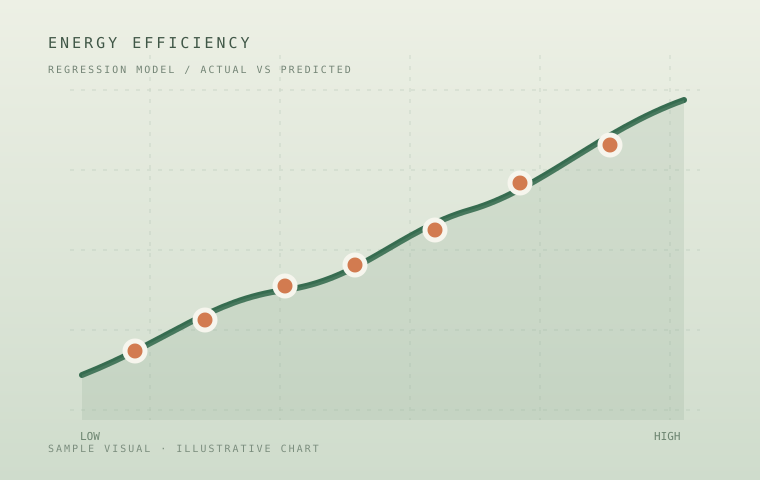

# Project Fieldnotes — GitHub Pages

개인 학부 실습 및 진행 중인 프로젝트를 소개하는 정적 포트폴리오 페이지입니다. 별도 빌드 도구 없이 GitHub Pages에서 바로 게시할 수 있습니다.

## 포함된 프로젝트

- MCP Supply Chain Radar — 진행 중인 설계·개발 프로젝트
- Energy Efficiency Regression
- YOLOv5 Mask Detection
- Mushroom Classification

## 로컬 미리보기

`index.html`을 브라우저에서 열면 페이지를 확인할 수 있습니다. 이미지 경로가 상대 경로이므로 `assets` 폴더를 `index.html`과 같은 위치에 유지해야 합니다.

## 프로젝트 이미지 교체 방법

각 프로젝트 이미지의 기본 파일은 `assets/images/` 폴더에 SVG 샘플 이미지로 들어 있습니다.

| 프로젝트 | 기본 이미지 |
|---|---|
| MCP Supply Chain Radar | `assets/images/mcp-cover.svg` |
| Energy Efficiency Regression | `assets/images/energy-cover.svg` |
| YOLOv5 Mask Detection | `assets/images/yolo-cover.svg` |
| Mushroom Classification | `assets/images/mushroom-cover.svg` |

실제 프로젝트 이미지로 바꾸려면 원하는 JPG, PNG, WebP 파일을 `assets/images/` 폴더에 넣고, `index.html` 안의 각 프로젝트 버튼에 있는 아래 형태의 `src` 값만 바꾸면 됩니다.

```html

```

상세 팝업에도 같은 이미지가 표시됩니다. `index.html` 하단의 `projectDetails` 객체에서 해당 프로젝트의 `image` 경로도 동일하게 변경하세요.

```js
energy: {
  image: 'assets/images/energy-cover.svg',
  // 나머지 프로젝트 정보
}
```

샘플 이미지는 레이아웃 미리보기를 위한 더미 비주얼이며 실제 프로젝트의 결과 화면이나 모델 성능을 나타내지 않습니다. YOLO 샘플의 수치 라벨도 장식용 예시입니다.

## GitHub Pages 게시

1. ZIP 압축을 해제합니다.
2. `index.html`, `README.md`, `assets/` 폴더를 새 GitHub 저장소의 루트에 업로드합니다.
3. 저장소의 **Settings → Pages**에서 배포 소스를 `Deploy from a branch`로 선택합니다.
4. 브랜치를 `main`, 폴더를 `/ (root)`로 지정하고 저장합니다.
5. 게시 완료 후 표시되는 GitHub Pages 주소로 접속합니다.

## 수정 참고

- 프로젝트 타일은 데스크톱에서 `1개 / 1개 / 2개` 배치로 구성되어 있습니다.
- 네 타일 모두 높이가 동일합니다.
- 태블릿과 모바일 화면에서는 화면 너비에 맞춰 재배치됩니다.
- 카드와 상세 팝업이 동일한 프로젝트 이미지 파일을 참조합니다.
